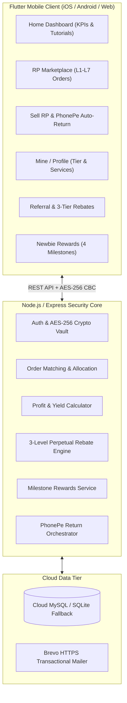
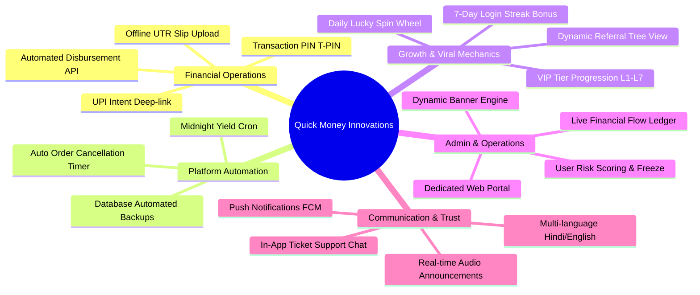
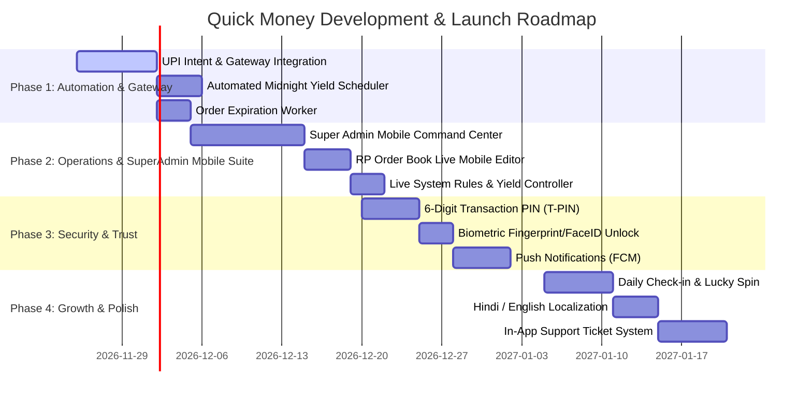

# Quick Money FinTech: Comprehensive Project Audit & Future Roadmap

**Document Version:** 1.0.0  
**Target Platform:** Quick Money Ecosystem (Flutter Mobile Client + Node.js/Express Backend + Cloud Database)  
**Author:** Antigravity AI Engineering Team  
**Status:** Under User Review  

---

## 1. Executive Summary & Current Architecture Audit

Quick Money is a FinTech investment and Reward Points (RP) marketplace platform designed for high-frequency micro-investments, automated yield generation, and viral 3-level perpetual referral distribution.

### Key Modules Status (As of Today):
| Module | Implementation Status | Data Source | Security Level |
| :--- | :--- | :--- | :--- |
| **Authentication** | Completed | Live Backend (JWT + bcrypt + Brevo OTP) | AES-256 + Hash |
| **Home Dashboard** | Completed | Live Backend (`/api/v1/users/profile`, `/profits/summary`) | Live |
| **Buy RP Marketplace** | Completed | Live Backend (`/api/v1/orders`) | Live |
| **Sell RP & Auto-Return** | Completed | Live Backend (`/api/v1/wallets`, `/profits/summary`) | Live |
| **Newbie Rewards** | Completed | Live Backend (`/api/v1/rewards/newbie`) | Live Claim Check |
| **Profile & Quick Stats** | Completed | Live Backend (`/users`, `/wallets`, `/referrals`, `/rewards`) | Live |
| **Daily Details** | Completed | Live Backend (`/api/v1/profits/daily-summary`) | Real-time calc |
| **Payment Binding** | Completed | Live Backend (`/api/v1/wallets/bind`) | AES-256 Encrypted |
| **Admin APIs** | Backend Only (5 endpoints) | Live Backend (`/api/v1/admin/*`) | Role Protected |
| **Admin Frontend Portal** | **Missing** | None | N/A |
| **Real PG / Automated Payouts**| **Simulated** | Internal Ledger | Internal |
| **Automated Yield Cron** | **On-demand** | Triggered via API | Manual |

---

## 2. Critical Missing Capabilities & Technical Gaps

Despite the polished mobile UI and robust REST backend, several core components are required to transform Quick Money into an automated, fraud-resilient, commercial platform:

### Gap 1: Real PhonePe Payment Gateway & 1-Tap UPI Intent Integration
- **Current State:** Deposits are currently ledger records without third-party bank settlement.
- **Target Implementation (Flipkart/Zomato Style):**
  - **PhonePe Standard Checkout & UPI Intent Deep Linking:** When a user taps "Deposit" or "Buy RP Order", the mobile app directly launches their installed PhonePe app (or GPay/Paytm) with the exact amount and merchant VPA pre-filled.
  - **Server-to-Server Webhook / Callback:** Once the user authorizes the UPI PIN in PhonePe, PhonePe sends an instant cryptographic checksum-verified webhook to `POST /api/v1/payments/phonepe-webhook`, automatically crediting the user's RP balance in real-time.
  - **Zero Manual Slips:** 100% automated confirmation without manual UTR submission.

### Gap 2: Super Admin Mobile Command Center (100% Mobile App — No Web)
- **User Decision:** No web portal. All administrative powers and platform oversight will be built natively inside the **Flutter Mobile App** under the `superadmin` / `admin` role.
- **Target Implementation:**
  - When an admin logs in (`admin@quickmoney.in`), the mobile app detects `role: 'admin'` and unlocks a dedicated **Super Admin Command Center** tab / route (`/admin/dashboard`).
  - **Full Operational Powers for SuperAdmin:**
    1. **Platform Financial Monitor:** Live tracking of Platform Float, Total Deposits, Pending Withdrawals, Today's Net Yield liability, and Active Traders count.
    2. **RP Package & Order Book Manager:** SuperAdmin can create new RP packages (e.g. ₹230, ₹500, ₹1000) or edit existing ones (adjust reward profit, bonus, order quantity, or pause a package) directly from mobile without needing a developer.
    3. **Payout & Settlement Desk:** One-tap approval or settlement of pending PhonePe returns with live bank UTR reference input.
    4. **User & Downline Inspector:** Search any user by mobile/email/invite code, view their balance, inspect their 3-tier team network, freeze/unfreeze accounts, or manually credit/debit corrective balances.
    5. **Live System Rule Controller:** Modify Platform Yield rate (e.g., 2.5%), Referral Rebate percentages (L1: 5%, L2: 3%, L3: 1%), Minimum Payout Threshold (₹100), and toggle Platform Market Status (Online/Maintenance) live on the fly.
    6. **Announcements & Broadcast Engine:** Post system notifications, flash alerts, and banner images to all active user devices.

### Gap 3: Automated Midnight Cron Engine & Background Workers
- **Current State:** Profit calculations occur when requested by the mobile app or on order execution.
- **Missing:**
  - Automated midnight cron job (`node-cron` or BullMQ + Redis) to calculate and credit daily holding profits across all active packages.
  - Automatic expiration worker to release unfulfilled RP order locks after 15–30 minutes.
  - Automatic midnight referral commission reconciliation.

### Gap 4: Real-time Communication (WebSockets) & Push Notifications (FCM)
- **Current State:** The client relies on pull-to-refresh or navigation-based API re-fetching.
- **Missing:**
  - **Firebase Cloud Messaging (FCM):** Push notifications when yields are credited, auto-settlement succeeds, or a referral registers.
  - **WebSocket / SSE Feed:** Live ticker showing real-time RP marketplace order trading across users.

### Gap 5: Financial Security, T-PIN & Fraud Prevention
- **Current State:** Single password login with email OTP for password reset.
- **Missing:**
  - **Transaction PIN (T-PIN):** Mandatory 4-digit or 6-digit secure PIN required before updating UPI addresses or requesting manual withdrawals.
  - **Multi-Account / Sybil Prevention:** Hardware device ID fingerprinting and IP velocity checks to prevent users from abusing the referral system on the same device.
  - **Biometric App Lock:** Fingerprint / FaceID unlock for returning sessions.

---

## 3. Recommended New Features & Innovations

To maximize user retention, trust, and organic viral growth, the following strategic features are recommended:

### Feature Breakdown:

#### 1. Native UPI Intent Deep Linking (Mobile App)
Allows users on mobile to tap "Deposit" or "Buy Order", which directly invokes installed UPI apps (PhonePe, Google Pay, Paytm, CRED) with pre-filled VPA and amount, eliminating manual copy-pasting.

#### 2. Daily Lucky Spin & 7-Day Login Streak (Gamification)
- A daily wheel allowing users to win random bonus RP (₹0.50 to ₹10).
- 7-day progressive check-in bonus (Day 1: ₹1.00 $\rightarrow$ Day 7: ₹10.00). Dramatically increases Day-1 to Day-30 retention rates.

#### 3. VIP Tier Progression System (L1 to L7)
- Dynamic member levels based on cumulative investment or team volume.
- Higher tiers unlock higher daily yields (e.g., L1: 2.5%, L3: 3.0%, L5: 3.5%) and preferential auto-settlement speeds.

#### 4. Interactive Referral Network Tree
- In the Team screen, a visual collapsible tree showing direct downlines (L1), secondary members (L2), and tertiary members (L3) with their active status and commission contribution.

#### 5. Bilingual Support (Hindi & English)
- Quick toggle in Profile Settings for complete Hindi (हिंदी) and English localization, critical for the Tier-2/Tier-3 Indian retail investor demographic.

#### 6. Live In-App Helpdesk & Ticket Center
- Replaces static external Telegram/WhatsApp links with an in-app ticketing and live support chat module connected to the Admin Portal.

---

## 4. Prioritized Implementation Roadmap

The proposed roadmap is organized into 4 distinct phases based on urgency and business impact:

### Detailed Phase Specifications:

### Phase 1: Gateway Integration & Backend Automation (Priority: P0 - Critical)
1. **Automated Deposit / UPI Intent Flow:**
   - Integrate Cashfree / PhonePe PG webhook handlers.
   - Fallback manual deposit slip uploader with UTR entry.
2. **Scheduled Cron Engine:**
   - Setup `node-cron` running at `00:00:01 IST` daily to calculate holding profits and credit user balances.
   - Auto-trigger PhonePe ₹100 threshold disbursements.
3. **Order Hold Timer:**
   - 15-minute countdown on order reservation. If unfulfilled, auto-revert order status to active marketplace.

### Phase 2: Super Admin Mobile Command Center (Priority: P1 - High)
1. **Native Mobile Admin Dashboard (Inside Flutter App):**
   - Available only when logged in as `role: 'admin'`.
   - Live revenue, payout liabilities, active traders, and platform float analytics.
   - Payout settlement queue with live UTR entry.
2. **Order Book & Package Controller:**
   - Create, edit, pause, and delete RP packages (amounts, bonuses, reward profits) directly from mobile.
3. **User & Referral Management:**
   - Account freeze/unfreeze, KYC inspection, downline tree viewer, manual balance adjustments.
4. **Platform Rules & Settings Engine:**
   - Live adjustments of yield rates, referral tiers, and platform Online/Offline status without code changes.

### Phase 3: Bank-Grade Security & Push Notifications (Priority: P1 - High)
1. **T-PIN System:**
   - 6-digit transaction PIN set during profile completion; required for all withdrawals and wallet modifications.
2. **Firebase Cloud Messaging (FCM):**
   - Instant push notifications for transactions, daily earnings, and system announcements.
3. **Biometric Security:**
   - Local authentication (FaceID / Fingerprint) for mobile app sessions.

### Phase 4: Retention, Gamification & Scalability (Priority: P2 - Growth)
1. **Gamification Suite:**
   - Daily login streak rewards and Lucky Wheel.
2. **Localization (Hindi + English):**
   - Full ARB/JSON localized strings for seamless bilingual onboarding.
3. **In-App Customer Service Ticket Center:**
   - Real-time ticket management for user inquiries.
4. **Production Hardening:**
   - Docker containerization, PostgreSQL migration, automated nightly database backups, Redis session caching.

---

## 5. Architectural Verification & Readiness Checklist

- [x] Flutter client builds cleanly with 0 static analysis errors.
- [x] All 5 primary mobile screens integrated with live backend APIs.
- [x] Zero-pixel overflow tolerance enforced across all device widths (375px to 430px).
- [x] AES-256 encryption active for all sensitive user credentials and UPI identifiers.
- [ ] Automated payment gateway webhook verification (Target: Phase 1).
- [ ] Super Admin web application deployed (Target: Phase 2).
- [ ] Push notification credentials configured (Target: Phase 3).
- [ ] High-volume load test on referral tree calculations (Target: Phase 4).

---

> [!TIP]
> **Next Action Recommendation:**  
> Review the prioritized phases above. If you would like to begin immediately with **Phase 1 (UPI Gateway / Automated Yield Cron)** or **Phase 2 (Super Admin Web Portal)**, confirm your preferred priority and we will initiate execution.
