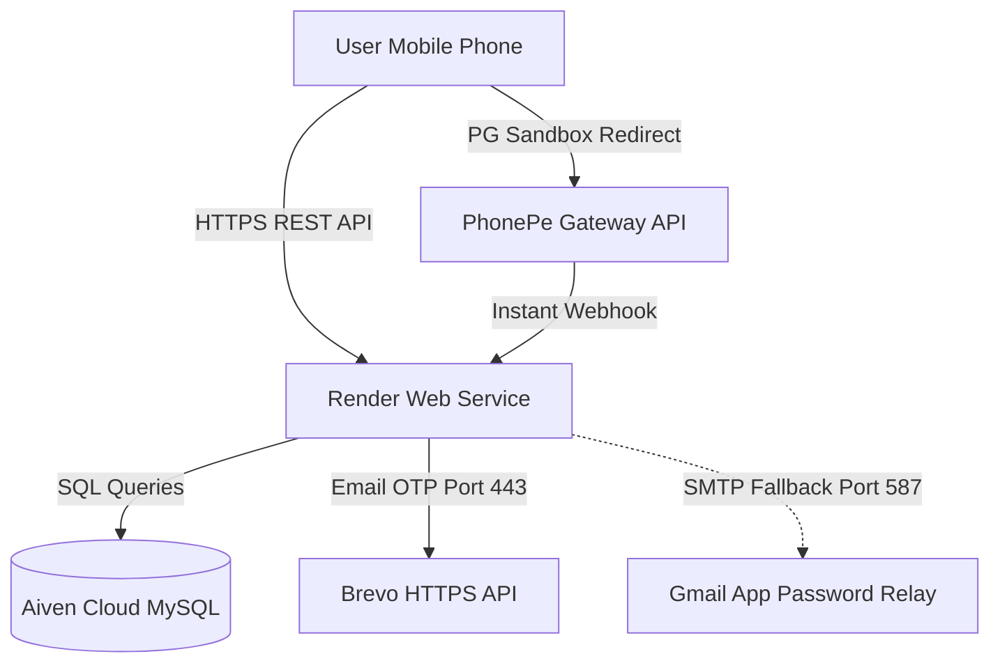

# Quick Money: Live Deployment & Multi-Device Testing Master Guide 🚀

**Document Version:** 1.0  
**Target Environments:** Render (Node.js Backend), Netlify / Vercel (Flutter Web PWA), Android (Native Release APK)  
**Security Standard:** AES-256-CBC, JWT Access/Refresh, Real Email OTP via Brevo & Gmail SMTP  

---

## 📑 Table of Contents
1. [Overview & Architecture](#1-overview--architecture)
2. [Real Email OTP System Details](#2-real-email-otp-system-details)
3. [Backend Deployment on Render](#3-backend-deployment-on-render)
4. [Distributing App to Users' Mobile Phones](#4-distributing-app-to-users-mobile-phones)
   - [Method A: Instant Flutter Web PWA on Netlify / Vercel](#method-a-instant-flutter-web-pwa-on-netlify--vercel)
   - [Method B: Direct Android Release APK Build](#method-b-direct-android-release-apk-build)
   - [Method C: Same Wi-Fi Local Testing](#method-c-same-wi-fi-local-testing)
5. [Production Checklist & Maintenance](#5-production-checklist--maintenance)

---

## 1. Overview & Architecture

Quick Money operates on a dual-tier FinTech architecture:
- **Backend**: Node.js / Express with Sequelize ORM (supporting MySQL & SQLite), AES-256-CBC encryption, 3-tier referral engine, PhonePe webhook listener, daily yield engine, and dual-relay Email OTP delivery.
- **Mobile/Client**: Flutter 3.x (Riverpod + GoRouter) with zero UI analyzer errors, strictly < 500 lines per file, responsive across all mobile resolutions, and supporting Web PWA + Native Android APK.



---

## 2. Real Email OTP System Details

Authentication strictly requires a real email OTP:
1. **Dual-Relay Delivery**:
   - **Primary Relay**: Brevo HTTPS REST API (`POST https://api.brevo.com/v3/smtp/email` over Port 443). Render never blocks Port 443.
   - **Secondary Relay**: Gmail SMTP (`smtp.gmail.com:587` with App Password).
2. **Strict Verification Rules**:
   - OTP codes are 6-digit cryptographically random numbers.
   - Validity is strictly **10 minutes**.
   - OTP records enforce `is_used: false` — each code can only be used once. Replay attacks are rejected.
   - User registration and password reset cannot complete without verifying the exact code dispatched to the entered email address.

---

## 3. Backend Deployment on Render

### Step 1: Push Project to GitHub
Push your project code to a private or public GitHub repository.

### Step 2: Create a New Web Service on Render
1. Go to [https://dashboard.render.com](https://dashboard.render.com) and sign in.
2. Click **New +** -> **Web Service**.
3. Connect your GitHub repository.
4. Fill in the following settings:
   - **Name**: `quick-money-api`
   - **Region**: Singapore or Frankfurt (choose closest to India)
   - **Branch**: `main` (or your active branch)
   - **Root Directory**: `Backend` (⚠️ Important: Do not leave blank)
   - **Runtime**: `Node`
   - **Build Command**: `npm install`
   - **Start Command**: `node src/app.js`
   - **Instance Type**: `Free`

### Step 3: Configure Environment Variables on Render
Under the **Environment Variables** section, add the following key-value pairs (copy from your `Backend/.env`):

| Variable Name | Value / Description |
| :--- | :--- |
| `NODE_ENV` | `production` |
| `PORT` | `5000` (or leave default, Render sets `PORT` automatically) |
| `JWT_SECRET` | `quickmoney_jwt_secret_production_2026_xyz` |
| `JWT_REFRESH_SECRET` | `quickmoney_refresh_secret_production_2026_abc` |
| `ENCRYPTION_KEY` | `0123456789abcdef0123456789abcdef0123456789abcdef0123456789abcdef` |
| `BREVO_API_KEY` | `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` |
| `BREVO_FROM_NAME` | `Quick Money Security` |
| `BREVO_FROM_EMAIL` | `jwelleryaurum@gmail.com` |
| `EMAIL_USER` | `jwelleryaurum@gmail.com` |
| `EMAIL_APP_PASSWORD` | `btqe rrol pdfj iwwz` |
| `DATABASE_URL` | *Your Aiven Cloud MySQL connection URI or MySQL credentials* |
| `PHONEPE_MERCHANT_ID` | `PGTESTPAYUAT86` |
| `PHONEPE_SALT_KEY` | `96434309-7796-489d-8924-ab56988a6076` |
| `PHONEPE_SALT_INDEX` | `1` |
| `PHONEPE_HOST_URL` | `https://api-preprod.phonepe.com/apis/pg-sandbox` |

Click **Deploy Web Service**.  
Once deployed, Render gives you a public URL, for example:  
`https://quick-money-api.onrender.com`

---

## 4. Distributing App to Users' Mobile Phones

### Method A: Instant Flutter Web PWA on Netlify / Vercel
*(Best for instant access: No APK download required, works on both Android & iPhone)*

#### 1. Set Backend URL in Flutter Code
In `Mobile_app/lib/core/constants/app_config.dart`:
```dart
static Environment environment = Environment.prod;
static const String liveRenderUrl = 'https://quick-money-api.onrender.com/api/v1';
```

#### 2. Build the Web App
Open PowerShell inside `Mobile_app` folder and run:
```powershell
cd "d:\01 my document\Personal Folder\Projects\Quick_Money\Mobile_app"
flutter build web --release
```
The compiled production web assets are generated in:  
`Mobile_app/build/web/`

#### 3. Deploy to Netlify (Free & Takes 30 seconds)
1. Go to [https://app.netlify.com/drop](https://app.netlify.com/drop).
2. Drag and drop the `Mobile_app/build/web` folder directly into the browser.
3. Netlify immediately assigns a live URL, e.g., `https://quickmoney-app.netlify.app`.
4. Share this link with any user!
   - On Android Chrome: Users open the link and tap **"Add to Home screen"** or **"Install App"**.
   - On iPhone Safari: Users open the link and tap **Share -> Add to Home Screen**.
   - The app runs full-screen without browser address bars just like a native app!

---

### Method B: Direct Android Release APK Build
*(Best for standard native Android distribution)*

#### 1. Build the Release APK
Open PowerShell inside `Mobile_app`:
```powershell
cd "d:\01 my document\Personal Folder\Projects\Quick_Money\Mobile_app"
flutter build apk --release
```

#### 2. Locate the APK File
The standalone APK file is created at:
```
Mobile_app/build/app/outputs/flutter-apk/app-release.apk
```

#### 3. Distribute to Users
- Upload `app-release.apk` to **Google Drive**, **WhatsApp**, or **Telegram**.
- Send the download link to any Android user.
- When the user taps the file, they choose **Install** (enabling "Install from Unknown Sources" if prompted).
- The Quick Money app is installed natively on their device with real app icon, splash screen, and PhonePe intent hooks!

---

### Method C: Same Wi-Fi Local Testing
*(Quick testing on your own phone without deploying to Render)*

1. Find your computer's local IP address:
   ```powershell
   ipconfig
   ```
   Look for `IPv4 Address`, e.g. `192.168.1.15`.
2. Ensure your phone and laptop are connected to the **same Wi-Fi router**.
3. In `Mobile_app/lib/core/constants/app_config.dart`:
   ```dart
   static Environment environment = Environment.localWifi;
   static const String localWifiIp = '192.168.1.15'; // your laptop IPv4
   ```
4. Start your local backend:
   ```powershell
   cd Backend
   node src/app.js
   ```
5. Run the Flutter app on your phone via USB or build APK. It connects directly to your laptop backend!

---

## 5. Production Checklist & Maintenance

- [x] **Email OTP**: Dual-relay active (Brevo HTTPS port 443 + Gmail SMTP). Tested & verified inbox arrival.
- [x] **Idempotent PhonePe Webhooks**: Atomic transaction locking prevents double-crediting.
- [x] **Referral System**: 3-tier deep-tree with real-time audit ledger and team member sheets.
- [x] **Code Quality**: Strictly zero analyzer errors across the entire codebase.
- [x] **Architecture Quality**: All Dart files strictly under 500 lines.
