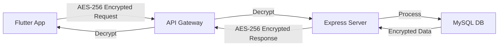
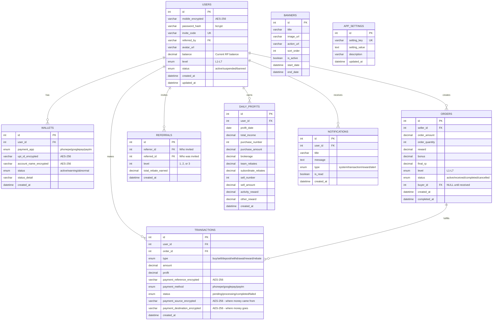
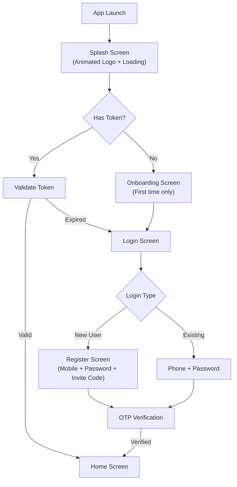
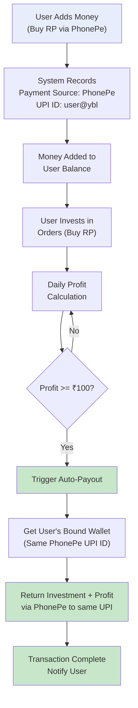

# 🚀 Quick Money Application — Full Implementation Plan

> **Project Type:** Money Investment & Reward Points Trading App  
> **Client Reference:** OnePay App (`https://land.onexx.top`)  
> **Frontend:** Flutter (Dart)  
> **Backend:** Node.js + Express.js (Free Hosting Ready)  
> **Database:** MySQL  
> **Security:** AES-256 Encryption + JWT Auth  

---

## 📱 Reference Screenshots Analysis

````carousel
**Screenshot 1 — App Icon (OnePay Reference)**

<!-- slide -->
**Screenshot 2 — Daily Details Screen**

<!-- slide -->
**Screenshot 3 — Daily Details (Full View)**

<!-- slide -->
**Screenshot 4 — Home Dashboard**

<!-- slide -->
**Screenshot 5 — Sell RP / Wallet Screen**

<!-- slide -->
**Screenshot 6 — Buy RP Marketplace**

<!-- slide -->
**Screenshot 7 — Profile / Mine Screen**

````

---

## 🏗️ 1. Backend Technology Decision

### Why **Node.js + Express.js**?

| Factor | Node.js + Express | Python FastAPI | PHP Laravel |
|--------|-------------------|----------------|-------------|
| **Free Hosting** | ✅ Render, Railway, Vercel, Cyclic | ✅ Render, Railway | ⚠️ Limited modern hosts |
| **MySQL Support** | ✅ Sequelize/Prisma ORM | ✅ SQLAlchemy | ✅ Eloquent |
| **Performance** | ✅ Non-blocking I/O | ✅ Async | ⚠️ Moderate |
| **Ecosystem** | ✅ Massive NPM packages | ✅ Good | ✅ Good |
| **Learning Curve** | ✅ Easy JavaScript | ⚠️ Python syntax | ⚠️ PHP framework |
| **AES-256 Support** | ✅ Native `crypto` module | ✅ `cryptography` | ✅ Built-in |
| **JWT Auth** | ✅ `jsonwebtoken` package | ✅ `PyJWT` | ✅ `tymon/jwt-auth` |
| **Free Hosting Options** | Render, Railway, Fly.io, Cyclic | Render, Railway | Limited |

> [!TIP]
> **Node.js + Express.js** chosen because:
> - JavaScript is universal — easy to find developers
> - **Render.com** offers forever-free tier for Node.js apps
> - **TiDB Cloud / PlanetScale / Aiven** offer free MySQL hosting
> - Native `crypto` module for AES-256 — no extra dependency
> - Excellent Sequelize ORM for MySQL
> - Socket.io for real-time notifications (future scope)

### Free Hosting Stack:
| Service | Purpose | Free Tier |
|---------|---------|-----------|
| **Render.com** | Backend API hosting | 750 hrs/month free |
| **Aiven / TiDB Cloud** | MySQL Database | 5GB free |
| **Cloudflare R2** | File/Image storage | 10GB free |

---

## 📂 2. Complete Folder Structure

> Exactly matching ICU_Mobile_App reference project structure

### Flutter Mobile App (`Mobile_app/`)

```
Quick_Money/
├── Backend/                              # Node.js Express API
│   ├── src/
│   │   ├── config/
│   │   │   ├── database.js               # MySQL Sequelize connection
│   │   │   ├── encryption.js             # AES-256 encryption/decryption helpers
│   │   │   └── app_config.js             # Environment config (dev/staging/prod)
│   │   ├── middleware/
│   │   │   ├── auth_middleware.js         # JWT token verification
│   │   │   ├── encryption_middleware.js   # Request/Response encryption
│   │   │   ├── rate_limiter.js           # API rate limiting
│   │   │   └── validator.js              # Request validation
│   │   ├── models/
│   │   │   ├── user_model.js             # User table
│   │   │   ├── wallet_model.js           # UPI/Payment wallet info
│   │   │   ├── transaction_model.js      # Buy/Sell transactions
│   │   │   ├── order_model.js            # RP order marketplace
│   │   │   ├── profit_model.js           # Daily profit tracking
│   │   │   ├── referral_model.js         # 3-level referral system
│   │   │   └── notification_model.js     # Push notifications
│   │   ├── routes/
│   │   │   ├── auth_routes.js            # Login, Register, OTP, Refresh
│   │   │   ├── user_routes.js            # Profile, Settings
│   │   │   ├── wallet_routes.js          # Add/Remove wallet, Bind UPI
│   │   │   ├── order_routes.js           # Buy RP, Sell RP, Order list
│   │   │   ├── transaction_routes.js     # Transaction history
│   │   │   ├── profit_routes.js          # Daily profit, Total earnings
│   │   │   ├── referral_routes.js        # Team, Invite, Rebates
│   │   │   └── notification_routes.js    # Notifications
│   │   ├── controllers/
│   │   │   ├── auth_controller.js
│   │   │   ├── user_controller.js
│   │   │   ├── wallet_controller.js
│   │   │   ├── order_controller.js
│   │   │   ├── transaction_controller.js
│   │   │   ├── profit_controller.js
│   │   │   ├── referral_controller.js
│   │   │   └── notification_controller.js
│   │   ├── services/
│   │   │   ├── auth_service.js           # Auth logic + token management
│   │   │   ├── payment_service.js        # PhonePe/UPI integration
│   │   │   ├── profit_calculator.js      # Profit calculation engine
│   │   │   ├── referral_service.js       # 3-level rebate calculation
│   │   │   └── notification_service.js   # Push notification sender
│   │   ├── utils/
│   │   │   ├── crypto_helper.js          # AES-256 encrypt/decrypt
│   │   │   ├── jwt_helper.js             # JWT sign/verify
│   │   │   ├── response_handler.js       # Standard API response format
│   │   │   └── logger.js                 # Winston logger
│   │   └── app.js                        # Express app entry point
│   ├── migrations/                       # Sequelize migrations
│   ├── seeders/                          # Test data seeders
│   ├── .env.example
│   ├── package.json
│   └── README.md
│
├── Mobile_app/                           # Flutter Application
│   ├── lib/
│   │   ├── main.dart                     # Entry point (ProviderScope + QuickMoneyApp)
│   │   ├── app.dart                      # MaterialApp.router with theme + GoRouter
│   │   │
│   │   ├── core/                         # ══ App-wide Infrastructure ══
│   │   │   ├── animations/
│   │   │   │   ├── app_animations.dart           # Reusable animation configs & durations
│   │   │   │   ├── page_transitions.dart         # fade, slideRight, slideUp, scale transitions
│   │   │   │   ├── shimmer_loading.dart          # ShimmerLoading, ShimmerOrderCard, ShimmerBalanceCard
│   │   │   │   ├── staggered_animation.dart      # Staggered list item entry animations
│   │   │   │   └── pulse_animation.dart          # Pulsing glow for active elements
│   │   │   │
│   │   │   ├── constants/
│   │   │   │   ├── app_config.dart               # Environment (dev/staging/prod), base URLs
│   │   │   │   ├── app_constants.dart            # App-wide constants (levels, limits, etc.)
│   │   │   │   └── asset_paths.dart              # Asset file path constants
│   │   │   │
│   │   │   ├── mock_data/
│   │   │   │   └── app_mock_data.dart            # All mock data for UI development
│   │   │   │
│   │   │   ├── network/
│   │   │   │   ├── api_client.dart               # Dio-based ApiClient with Riverpod
│   │   │   │   ├── api_endpoints.dart            # All REST API endpoints
│   │   │   │   ├── api_error_handler.dart         # DioException → ApiException parser
│   │   │   │   ├── api_exception.dart            # Exception hierarchy
│   │   │   │   ├── api_interceptor.dart          # Auth token injection, 401 refresh
│   │   │   │   └── api_response.dart             # Generic ApiResponse<T> wrapper
│   │   │   │
│   │   │   ├── providers/
│   │   │   │   ├── auth_provider.dart            # AuthState + AuthNotifier
│   │   │   │   ├── user_provider.dart            # User profile state
│   │   │   │   ├── wallet_provider.dart          # Wallet/UPI state
│   │   │   │   ├── order_provider.dart           # Buy/Sell orders state
│   │   │   │   ├── transaction_provider.dart     # Transaction history state
│   │   │   │   ├── profit_provider.dart          # Profit/earnings state
│   │   │   │   ├── referral_provider.dart        # Team/referral state
│   │   │   │   └── data_providers.dart           # Barrel export of all providers
│   │   │   │
│   │   │   ├── route/
│   │   │   │   └── app_route.dart                # GoRouter config with ShellRoute
│   │   │   │
│   │   │   ├── services/
│   │   │   │   ├── auth_service.dart             # Login, OTP, register, logout
│   │   │   │   ├── encryption_service.dart       # AES-256 encryption/decryption
│   │   │   │   ├── secure_storage_service.dart   # flutter_secure_storage wrapper
│   │   │   │   └── notification_service.dart     # Local/push notification handler
│   │   │   │
│   │   │   ├── theme/
│   │   │   │   ├── app_colors.dart               # Full color palette (brand, status, semantic)
│   │   │   │   ├── app_spacing.dart              # Spacing tokens (4px grid), border radius, shadows
│   │   │   │   ├── app_theme.dart                # AppTheme.lightTheme / AppTheme.darkTheme
│   │   │   │   ├── app_typography.dart           # Typography scale (h1-h4, body, caption)
│   │   │   │   └── theme_provider.dart           # ThemeModeNotifier (light/dark toggle)
│   │   │   │
│   │   │   └── utils/
│   │   │       ├── custom_snackbar.dart          # ✅ Custom SnackBar (success/error/info/warning)
│   │   │       ├── custom_loader.dart            # ✅ Custom Loader (fullscreen/inline/overlay)
│   │   │       ├── date_formatter.dart           # Date formatting utilities
│   │   │       ├── currency_formatter.dart       # ₹ currency formatting
│   │   │       └── validators.dart               # Form validation helpers
│   │   │
│   │   ├── features/                     # ══ Feature Modules ══
│   │   │   │
│   │   │   ├── authentication/
│   │   │   │   ├── screens/
│   │   │   │   │   ├── splash_screen.dart        # Animated splash with logo
│   │   │   │   │   ├── onboarding_screen.dart    # First-time onboarding slides
│   │   │   │   │   ├── login_screen.dart         # Phone + Password login
│   │   │   │   │   ├── register_screen.dart      # Registration + Invite code
│   │   │   │   │   ├── otp_screen.dart           # OTP verification
│   │   │   │   │   └── forgot_password_screen.dart
│   │   │   │   └── widgets/
│   │   │   │       ├── auth_header.dart          # Animated auth page header
│   │   │   │       ├── phone_input_field.dart    # Styled phone input
│   │   │   │       └── otp_input_field.dart      # Animated OTP boxes
│   │   │   │
│   │   │   ├── home/
│   │   │   │   ├── screens/
│   │   │   │   │   └── home_screen.dart          # Main dashboard
│   │   │   │   └── widgets/
│   │   │   │       ├── promo_banner_carousel.dart    # Animated banner carousel
│   │   │   │       ├── stats_summary_card.dart       # Buy/Sell stats card
│   │   │   │       ├── tutorial_section.dart         # Tutorial cards
│   │   │   │       └── home_header.dart              # Animated gradient header
│   │   │   │
│   │   │   ├── buy_rp/
│   │   │   │   ├── screens/
│   │   │   │   │   └── buy_rp_screen.dart        # Order marketplace with level tabs
│   │   │   │   └── widgets/
│   │   │   │       ├── level_tab_bar.dart         # L1-L7 animated tab pills
│   │   │   │       ├── order_card.dart            # Order item card with receive button
│   │   │   │       ├── order_filter_bar.dart      # Sort & refresh bar
│   │   │   │       └── receive_order_dialog.dart  # Payment confirmation dialog
│   │   │   │
│   │   │   ├── sell_rp/
│   │   │   │   ├── screens/
│   │   │   │   │   └── sell_rp_screen.dart        # Sell overview + wallet management
│   │   │   │   └── widgets/
│   │   │   │       ├── today_overview_card.dart    # Receipt amount overview
│   │   │   │       ├── wallet_info_card.dart       # PhonePe/UPI wallet card
│   │   │   │       ├── add_wallet_button.dart      # Add wallet action
│   │   │   │       ├── sell_faster_card.dart       # Sell acceleration feature
│   │   │   │       └── promo_tutorial_banner.dart  # USDT tutorial banner
│   │   │   │
│   │   │   ├── profile/
│   │   │   │   ├── screens/
│   │   │   │   │   ├── profile_screen.dart        # Mine tab - user profile
│   │   │   │   │   ├── account_security_screen.dart
│   │   │   │   │   ├── bind_payment_screen.dart   # Add UPI/PhonePe
│   │   │   │   │   └── faq_screen.dart            # Common problems
│   │   │   │   └── widgets/
│   │   │   │       ├── profile_header.dart         # Avatar + mobile + invite code
│   │   │   │       ├── balance_card.dart           # Current balance card
│   │   │   │       ├── team_card.dart              # 3-level rebate team card
│   │   │   │       └── menu_list_tile.dart         # Animated settings menu item
│   │   │   │
│   │   │   ├── daily_details/
│   │   │   │   ├── screens/
│   │   │   │   │   └── daily_details_screen.dart  # Daily income breakdown
│   │   │   │   └── widgets/
│   │   │   │       ├── income_header_card.dart     # Today's total income banner
│   │   │   │       ├── purchase_data_card.dart     # Purchase stats
│   │   │   │       ├── recharge_data_card.dart     # USDT/TRX recharge data
│   │   │   │       ├── sale_data_card.dart         # Sale stats
│   │   │   │       └── platform_rewards_card.dart  # Platform activity rewards
│   │   │   │
│   │   │   ├── transactions/
│   │   │   │   ├── screens/
│   │   │   │   │   └── transaction_history_screen.dart
│   │   │   │   └── widgets/
│   │   │   │       └── transaction_tile.dart       # Animated transaction item
│   │   │   │
│   │   │   ├── referral/
│   │   │   │   ├── screens/
│   │   │   │   │   ├── team_screen.dart           # My team overview
│   │   │   │   │   └── invite_screen.dart         # Share invite code
│   │   │   │   └── widgets/
│   │   │   │       ├── referral_tree.dart          # 3-level visual tree
│   │   │   │       └── earnings_card.dart          # Team earnings summary
│   │   │   │
│   │   │   └── rewards/
│   │   │       ├── screens/
│   │   │       │   └── newbie_rewards_screen.dart  # New user rewards
│   │   │       └── widgets/
│   │   │           └── reward_card.dart            # Animated reward item
│   │   │
│   │   └── shared/                       # ══ Cross-Feature Shared ══
│   │       ├── models/
│   │       │   ├── user_model.dart                # User data model
│   │       │   ├── wallet_model.dart              # Wallet/UPI model
│   │       │   ├── order_model.dart               # RP Order model
│   │       │   ├── transaction_model.dart         # Transaction model
│   │       │   ├── profit_model.dart              # Profit/earnings model
│   │       │   ├── referral_model.dart            # Referral/team model
│   │       │   ├── banner_model.dart              # Promo banner model
│   │       │   └── daily_detail_model.dart        # Daily details model
│   │       │
│   │       └── widgets/
│   │           ├── app_scaffold.dart              # Standard screen wrapper with ScreenState
│   │           ├── main_shell.dart                # Bottom nav + FAB (Support chat)
│   │           ├── glass_card.dart                # Glassmorphism card (BackdropFilter)
│   │           ├── animated_card.dart             # Card with entry animation
│   │           ├── gradient_card.dart             # Gradient background card
│   │           ├── animated_button.dart           # Scale/bounce button animation
│   │           ├── state_widgets.dart             # Loading/Empty/Error/Offline widgets
│   │           ├── animated_counter.dart          # Counting number animation (for amounts)
│   │           ├── status_badge.dart              # Status pill badges
│   │           ├── section_header.dart            # Reusable section title
│   │           └── floating_support_button.dart   # Chat/support FAB
│   │
│   ├── assets/
│   │   ├── images/
│   │   │   ├── logo.png                  # Quick Money logo
│   │   │   ├── splash_bg.png            # Splash background
│   │   │   ├── onboarding_1.png         # Onboarding slides
│   │   │   ├── onboarding_2.png
│   │   │   ├── onboarding_3.png
│   │   │   ├── team_illustration.png    # Team/referral illustration
│   │   │   └── tutorial_illustration.png
│   │   ├── icons/
│   │   │   ├── phonepe_icon.png         # PhonePe logo
│   │   │   ├── rp_badge.png            # RP badge icon
│   │   │   └── usdt_icon.png           # USDT coin icon
│   │   └── animations/
│   │       ├── loading.json             # Lottie loading animation
│   │       ├── success.json             # Lottie success animation
│   │       └── empty.json              # Lottie empty state animation
│   │
│   ├── pubspec.yaml
│   ├── analysis_options.yaml
│   └── README.md
│
└── Development documents/                # Client screenshots & reference docs
    ├── 1.jpeg - 7.jpeg
    └── New Text Document.txt
```

---

## 🎨 3. Design System & UI Enhancement Plan

### Color Palette (Enhanced from Screenshots)

```
Primary:         #1A44B8 (Royal Blue — header, nav, buttons)
Primary Dark:    #0D2B7A (Deep Blue — gradients)
Primary Light:   #E8EDFB (Light Blue — backgrounds, tints)
Accent/Gold:     #FFB800 (Gold — rewards, highlights)
Accent/Amber:    #FF9500 (Orange — promotions, badges)

Success/Green:   #00C853 (Profit, positive values, rewards)
Error/Red:       #FF3B30 (Warnings, cancel, errors, logout)
Warning/Yellow:  #FFCC02 (UPI warnings, caution)
Info/Teal:       #00BCD4 (Info snackbar, tutorials)

Background:      #F5F7FA (Light gray page background)
Surface:         #FFFFFF (Cards, panels)
Text Primary:    #1A1A2E (Dark navy, headings)
Text Secondary:  #6B7280 (Gray, subtitles, labels)
Text Muted:      #9CA3AF (Light gray, hints)

Gradient Start:  #1A44B8 (Blue)
Gradient End:    #2962FF (Bright Blue)

Card Shadow:     rgba(26, 68, 184, 0.08)
```

### Animation Strategy (Next-Level UI)

| Element | Animation Type | Package |
|---------|---------------|---------|
| **Page Entry** | Slide Up + Fade (400ms) | `flutter_animate` |
| **Cards** | Scale In + Fade (staggered 100ms delay each) | `flutter_animate` |
| **Balance Amount** | Counting animation (0 → actual value) | Custom `AnimatedCounter` |
| **Buttons** | Scale bounce on tap (0.95 → 1.0) | `flutter_animate` |
| **Tab Switch** | Smooth slide + cross-fade | `AnimatedSwitcher` |
| **List Items** | Staggered slide-in from right | `flutter_animate` + `flutter_staggered_animations` |
| **Banner Carousel** | Auto-scroll + smooth page transition | `smooth_page_indicator` |
| **Shimmer Loading** | Skeleton shimmer effect | `shimmer` |
| **Pull to Refresh** | Lottie animation refresh | `lottie` |
| **Navigation** | Hero transitions + shared axis | `animations` (Material Motion) |
| **Floating Button** | Pulsing glow + bounce | Custom `AnimationController` |
| **Profit Numbers** | Color change green/red + slide | `flutter_animate` |
| **Gradient Headers** | Animated gradient shift | Custom `AnimationController` |
| **Glassmorphism** | Backdrop blur + frosted glass | `BackdropFilter` + `dart:ui` |
| **Particle Effects** | Confetti on rewards/profit | `confetti` |
| **Lottie** | Success, loading, empty states | `lottie` |

### Key Flutter Packages for UI

```yaml
dependencies:
  # State Management
  flutter_riverpod: ^3.4.3
  
  # Navigation
  go_router: ^18.0.1
  
  # HTTP & Networking
  dio: ^5.11.1
  
  # Animations
  flutter_animate: ^4.5.2              # Micro-animations
  flutter_staggered_animations: ^1.1.1  # Staggered list animations
  lottie: ^3.1.0                        # Lottie JSON animations
  confetti: ^0.8.0                      # Celebration effects
  smooth_page_indicator: ^1.2.0         # Carousel dots
  animations: ^2.0.11                   # Material motion transitions
  
  # UI Components  
  google_fonts: ^8.2.1                  # Inter / Space Grotesk fonts
  lucide_icons_flutter: ^3.1.20         # Modern icon set
  fl_chart: ^1.2.0                      # Charts for profit visualization
  shimmer: ^3.0.0                       # Skeleton loading
  cached_network_image: ^3.4.1          # Image caching
  carousel_slider: ^5.0.0              # Banner carousel
  
  # iOS Style / Cupertino
  cupertino_icons: ^1.0.8              # iOS icons
  # (CupertinoActionSheet, CupertinoAlertDialog used natively)
  
  # Security
  flutter_secure_storage: ^11.2.0      # Encrypted local storage
  encrypt: ^5.0.3                       # AES-256 encryption in Dart
  crypto: ^3.0.5                        # SHA/HMAC hashing
  
  # Utility
  intl: ^0.20.3                        # Date/currency formatting
  url_launcher: ^6.3.3                # Open external links
  share_plus: ^10.0.0                  # Share invite code
  clipboard: ^0.1.3                    # Copy invite code
  package_info_plus: ^10.2.2           # App version info
  pin_code_fields: ^10.1.1             # OTP input
  
  # Storage
  shared_preferences: ^2.3.3          # Local settings storage
```

---

## 🔐 4. Security Architecture

### AES-256 Encryption Flow



### Security Layers

| Layer | Implementation |
|-------|---------------|
| **Transport** | HTTPS/TLS (SSL on hosting) |
| **Data Encryption** | AES-256-CBC for sensitive data (passwords, UPI IDs, wallet info) |
| **Auth** | JWT Access Token (15min) + Refresh Token (7 days) |
| **Token Storage** | `flutter_secure_storage` (Keychain iOS / Keystore Android) |
| **API Security** | Rate Limiting, Request Validation, CORS, Helmet.js |
| **DB Security** | Parameterized queries (Sequelize ORM), encrypted columns |
| **OTP** | Time-based OTP with expiry (5 min) |
| **Session** | Auto-logout on 401, session invalidation on password change |
| **Input Validation** | Server-side + Client-side validation |
| **Logging** | Audit trail for all financial transactions |

### What Gets Encrypted (AES-256)
- ✅ User passwords (bcrypt hash + AES-256)
- ✅ UPI IDs / PhonePe numbers
- ✅ Wallet binding information
- ✅ Transaction amounts and details
- ✅ Invite codes (at rest)
- ✅ API request/response body (sensitive endpoints)
- ❌ Non-sensitive display data (banners, tutorials) — plain text for performance

---

## 🗄️ 5. MySQL Database Schema



---

## 📱 6. Screen-by-Screen Implementation Plan

### 6.1 Authentication Flow



#### Splash Screen Design:
- **Animated gradient background** (blue → deep blue shift)
- **Logo** with scale-in + fade animation
- **App name** "Quick Money" with typing animation
- **Loading indicator** — custom animated dots

#### Login Screen Design:
- **Glassmorphism card** floating over gradient background
- **Phone input** with country code (+91) and animated label
- **Password input** with animated show/hide toggle
- **Login button** with shimmer gradient + scale bounce on tap
- **Register link** with slide-up entrance
- **Forgot Password** link

#### Register Screen Design:
- **Stepper form** (Phone → Password → Invite Code → OTP)
- **Animated progress bar** at top
- **Invite code field** with paste button
- **Terms & conditions** checkbox with animated check

---

### 6.2 Home Screen (Tab 1 — Dashboard)

Based on **Screenshot 4**:

| Section | Design Enhancement |
|---------|-------------------|
| **Header** | Animated gradient (blue → indigo) with wave pattern overlay, user greeting "Good Morning, User!" with fade-in |
| **Banner Carousel** | Auto-scrolling PageView with smooth dot indicator, parallax effect on scroll, 3D card flip transition |
| **Stats Card** | Glassmorphism card with animated counters (Buy qty, Buy amount, Sell today, Total revenue), numbers count up from 0 |
| **Tutorial Section** | Expandable animated cards with slide-right entry, illustration on right side |
| **Support FAB** | Floating blue circle with pulsing glow animation, headphone icon |

**Animations:**
- Header gradient continuously shifts subtly
- Stats numbers do counting animation on load
- Each section enters with staggered fade-up (100ms delay between)
- Pull-to-refresh with custom Lottie animation
- Banner auto-scrolls every 5 seconds with smooth ease-in-out

---

### 6.3 Buy RP Screen (Tab 2 — Marketplace)

Based on **Screenshot 6**:

| Section | Design Enhancement |
|---------|-------------------|
| **Level Tabs** | Horizontal scrollable pills (L1-L7), selected tab has gradient fill + scale animation, unselected are outlined |
| **Sort/Filter Bar** | Dropdown with animated chevron rotation, refresh button with spin animation on tap |
| **Order Cards** | White cards with left accent border (color by level), staggered slide-in from right |
| **Receive Button** | Gradient blue button with ripple + scale bounce, haptic feedback |
| **Reward Text** | Green color with "+2.0" bonus badge pulsing glow |

**Animations:**
- Tab switch: content cross-fades with slide direction matching tab position
- Order list: staggered entrance (each card 80ms delay)
- Refresh: cards slide out, shimmer loading, cards slide in fresh
- Receive button: on tap → scale to 0.9 → bounce to 1.05 → settle at 1.0
- Pull down: order cards collapse, shimmer skeleton appears

---

### 6.4 Sell RP Screen (Tab 3 — Wallet Management)

Based on **Screenshot 5**:

| Section | Design Enhancement |
|---------|-------------------|
| **Overview Card** | Gradient light-blue card with glassmorphism effect, amount with animated counter, "Record" outlined button |
| **Tutorial Banner** | Dark gradient banner with USDT coin animated floating effect |
| **Wallet Card** | PhonePe icon with purple accent, UPI info, warning badge animated shake, status colors |
| **Action Buttons** | "Add Wallet" (green outlined, + icon bounce) and "Sell Faster" (gradient filled) side by side |

**Animations:**
- Overview card: slides down from header area on load
- Amount: counting animation 0 → 1599.0
- Warning badge: subtle shake animation (attention grabber)
- Wallet card: slide-in from left
- Add Wallet button: "+" icon does a rotation on hover/focus

---

### 6.5 Profile/Mine Screen (Tab 4)

Based on **Screenshot 7**:

| Section | Design Enhancement |
|---------|-------------------|
| **Profile Header** | Gradient blue background extending into body, circular avatar with glowing border animation, mobile number with animated eye toggle |
| **Invite Code** | Copy button with animated checkmark on copy success, confetti micro-burst |
| **Balance Card** | Glassmorphism card with large animated counter for balance, right arrow with slide-right hint animation |
| **Team Card** | "My Team" red badge with bounce entrance, "3-LEVEL" text gradient (red → blue), team illustration with floating animation |
| **Menu Items** | Each tile slides in staggered from right, chevron (→) animated on hover, icon colors matching their function |
| **Logout Button** | Red outlined button, confirmation dialog with slide-up animation |

**Menu Items Design:**
```
🎁 Newbie Rewards     →  (Gift icon, gold accent)
💚 Bind Payment APP   →  (Download icon, green accent)
❓ Common Problem      →  (Question icon, purple accent)
🎧 Online Service     →  (Headphone icon, blue accent)
🔒 Account Security   →  (Lock icon, teal accent)
📢 Official Channel   →  (Megaphone icon, indigo accent)
```

---

### 6.6 Daily Details Screen

Based on **Screenshots 2 & 3**:

| Section | Design Enhancement |
|---------|-------------------|
| **Income Banner** | Dark gradient (black → deep blue) with date, total income with animated counter and ₹ symbol |
| **Purchase Data** | White card with 2x2 grid, each number has counting animation, subtle card elevation |
| **Recharge Data** | Card with USDT/TRX pill badges (black background), values animated |
| **Sale Data** | Similar to purchase card, slide-in animation |
| **Platform Rewards** | Bottom card with activity/other values, subtle gradient border |

---

## 🧩 7. Core Shared Components

### 7.1 `custom_snackbar.dart` (Copied from ICU Reference)
- **4 variants:** `showSuccess()`, `showError()`, `showInfo()`, `showWarning()`
- **Dark/Light mode** aware colors
- **Animated entry:** slideY + fade (400ms)
- **Styled:** Rounded 16px, colored border, circular icon, box shadow glow
- **Auto-dismiss:** 3 seconds default, configurable
- **Font:** Space Grotesk, bold 700

### 7.2 `custom_loader.dart` (New — Custom Built)
```dart
/// Three loading modes:
/// 1. CustomLoader.fullScreen() — Overlay entire screen with backdrop blur + centered Lottie
/// 2. CustomLoader.inline() — Small loader for inside cards/buttons  
/// 3. CustomLoader.overlay() — Semi-transparent overlay on specific widget
/// 4. CustomLoader.shimmer() — Skeleton shimmer for content areas
///
/// Features:
/// - Lottie animation support
/// - Custom message text below loader
/// - Cancelable (optional cancel button)
/// - Auto-timeout (prevents infinite loading)
/// - Dark/Light theme aware
```

### 7.3 `app_scaffold.dart` — Screen State Management
```dart
enum ScreenState { loading, success, error, empty, offline }

/// Wraps every screen with automatic state handling:
/// - loading → Shows CustomLoader.fullScreen()
/// - error → Shows error state with retry button
/// - empty → Shows empty illustration with message
/// - offline → Shows no-internet state
/// - success → Shows actual content
```

---

## ⚙️ 8. Mock Data Strategy (Phase 1 — UI Only)

Since we're building UI first with mock data, all mock data will be centralized in `core/mock_data/app_mock_data.dart`:

```dart
class AppMockData {
  // User
  static final mockUser = UserModel(
    id: 1, mobile: '919835913180', inviteCode: 'xOrZx2yO',
    balance: 51.07, level: 'L1', avatar: 'assets/images/avatar.png'
  );
  
  // Orders (Buy RP)
  static final mockOrders = [
    OrderModel(amount: 285.0, quantity: 62, reward: 8.55, bonus: 2.0, finalRp: 295.55, level: 'L1'),
    OrderModel(amount: 300.0, quantity: 60, reward: 9.0, bonus: 2.0, finalRp: 311.00, level: 'L1'),
    // ... more orders for each level
  ];
  
  // Wallet
  static final mockWallet = WalletModel(
    paymentApp: 'phonepe', upiId: '6***', status: 'warning', 
    statusDetail: 'UPI Abnormal'
  );
  
  // Daily Details
  static final mockDailyDetail = DailyDetailModel(
    date: '2026-11-01', totalIncome: 38.75,
    purchaseNumber: 1, purchaseAmount: 1550.0, brokerage: 38.75,
    teamRebates: 0.0, sellNumber: 5, sellAmount: 1599.0
  );
  
  // Stats Summary
  static final mockStats = { 
    'buyQuantity': 1, 'buyAmount': 1550.0, 
    'sellToday': 1599.0, 'totalRevenue': 38.75 
  };
  
  // Banners
  static final mockBanners = [
    BannerModel(title: 'Subordinate User Growth Top 10', image: '...'),
    BannerModel(title: 'USDT Top-up', image: '...'),
    BannerModel(title: 'Deposit USDT & Get Extra Bonus', image: '...'),
  ];
}
```

> [!IMPORTANT]
> **Mock Data Switch:** `ApiEndpoints.useMockData = true` flag will toggle between mock and real API data. All providers will check this flag.

---

## 🔄 9. Payment Return Flow (PhonePe Integration)



### Data Stored Per Transaction:
```
├── Payment Source (encrypted):     PhonePe | Google Pay | Paytm
├── Source UPI ID (encrypted):      user@ybl
├── Amount Deposited:               ₹1550.00
├── Investment Orders:              [Order IDs]
├── Profit Accumulated:            ₹38.75
├── Payout Trigger:                 When profit >= ₹100
├── Payout Destination (encrypted): Same UPI as source
├── Payout Amount:                  Investment + Profit
├── Payout Status:                  pending/processing/completed/failed
└── Transaction Audit Trail:        All timestamps & statuses
```

---

## 📋 10. Phase-Wise Implementation Roadmap

### Phase 1: UI Foundation (Current — Mock Data) 🎯
> **Goal:** Build beautiful, animated Flutter UI with mock data

| # | Task | Priority | Est. Time |
|---|------|----------|-----------|
| 1.1 | Create Flutter project + folder structure | 🔴 Critical | 30 min |
| 1.2 | Setup theme (colors, typography, spacing) | 🔴 Critical | 1 hr |
| 1.3 | Create `custom_snackbar.dart` (copy from ICU) | 🔴 Critical | 30 min |
| 1.4 | Create `custom_loader.dart` | 🔴 Critical | 1 hr |
| 1.5 | Create shared widgets (AppScaffold, MainShell, GlassCard, etc.) | 🔴 Critical | 2 hrs |
| 1.6 | Create all data models | 🔴 Critical | 1 hr |
| 1.7 | Create mock data file | 🔴 Critical | 1 hr |
| 1.8 | Setup GoRouter + navigation | 🔴 Critical | 1 hr |
| 1.9 | Build Splash Screen (animated) | 🟡 High | 1 hr |
| 1.10 | Build Login/Register screens | 🟡 High | 2 hrs |
| 1.11 | Build Home Screen (dashboard + carousel) | 🟡 High | 3 hrs |
| 1.12 | Build Buy RP Screen (marketplace) | 🟡 High | 2 hrs |
| 1.13 | Build Sell RP Screen (wallet mgmt) | 🟡 High | 2 hrs |
| 1.14 | Build Profile/Mine Screen | 🟡 High | 2 hrs |
| 1.15 | Build Daily Details Screen | 🟢 Medium | 1.5 hrs |
| 1.16 | Add all animations (flutter_animate) | 🟡 High | 3 hrs |
| 1.17 | Polish UI + responsive layout | 🟢 Medium | 2 hrs |

**Phase 1 Total: ~24 hours**

### Phase 2: Backend API Development
> **Goal:** Build secure Node.js backend with MySQL

| # | Task | Est. Time |
|---|------|-----------|
| 2.1 | Setup Node.js + Express + Sequelize + MySQL | 2 hrs |
| 2.2 | Create all database migrations | 2 hrs |
| 2.3 | Implement AES-256 encryption helpers | 1 hr |
| 2.4 | Build Auth APIs (register, login, OTP, refresh) | 3 hrs |
| 2.5 | Build User APIs (profile, settings) | 1.5 hrs |
| 2.6 | Build Wallet APIs (add, remove, bind UPI) | 2 hrs |
| 2.7 | Build Order APIs (create, list, receive, filter) | 3 hrs |
| 2.8 | Build Transaction APIs (history, details) | 2 hrs |
| 2.9 | Build Profit Calculator + Daily profit API | 3 hrs |
| 2.10 | Build Referral/Team APIs (3-level rebate) | 2 hrs |
| 2.11 | Build Notification APIs | 1 hr |
| 2.12 | Add rate limiting, validation, security middleware | 2 hrs |
| 2.13 | Testing + Seeder data | 2 hrs |

**Phase 2 Total: ~26 hours**

### Phase 3: Integration & Live Data
> **Goal:** Connect Flutter app to backend

| # | Task | Est. Time |
|---|------|-----------|
| 3.1 | Setup Dio ApiClient + interceptors | 2 hrs |
| 3.2 | Replace mock data with API calls in all providers | 4 hrs |
| 3.3 | Implement JWT auth flow + token refresh | 2 hrs |
| 3.4 | Implement encryption service in Flutter | 1.5 hrs |
| 3.5 | End-to-end testing all flows | 3 hrs |

**Phase 3 Total: ~12.5 hours**

### Phase 4: Deployment & Hosting
> **Goal:** Deploy backend + share APK

| # | Task | Est. Time |
|---|------|-----------|
| 4.1 | Deploy backend to Render.com | 1 hr |
| 4.2 | Setup MySQL on Aiven/TiDB Cloud | 1 hr |
| 4.3 | Configure environment variables | 30 min |
| 4.4 | Build release APK | 30 min |
| 4.5 | Final testing on production | 2 hrs |

**Phase 4 Total: ~5 hours**

---

## ⚡ 11. Key Technical Decisions Summary

| Decision | Choice | Reason |
|----------|--------|--------|
| **Backend** | Node.js + Express.js | Free hosting on Render, native crypto for AES-256 |
| **ORM** | Sequelize | Best MySQL support for Node.js, migrations, seeders |
| **Database** | MySQL | Client requirement, free tiers available |
| **State Mgmt** | Riverpod 3.x | Same as reference project, Notifier pattern |
| **Routing** | GoRouter | Declarative, ShellRoute for bottom nav |
| **HTTP** | Dio | Interceptors for auth, error handling |
| **Encryption** | AES-256-CBC | Both server (crypto) and client (encrypt package) |
| **Auth** | JWT + Refresh Token | Industry standard, auto-refresh on 401 |
| **Animations** | flutter_animate + Lottie | Declarative animations, pre-built Lottie files |
| **Icons** | Lucide Icons | Modern, consistent icon set |
| **Fonts** | Inter (body) + Space Grotesk (numbers) | Clean, professional, financial app feel |

---

> [!CAUTION]
> **Important Notes:**
> 1. This app involves **financial transactions** — security is paramount. Every payment-related data MUST be encrypted.
> 2. The **3-level referral system** needs careful calculation logic to avoid errors in commission distribution.
> 3. **Payment return via same source** (e.g., PhonePe → PhonePe) requires storing the exact payment method securely.
> 4. For **production**, PhonePe/UPI integration will require merchant API credentials and compliance approvals.
> 5. **USDT/TRX features** visible in screenshots — we'll implement UI for these but actual crypto integration is Phase 5+ scope.

---

## ✅ Next Steps

**Please review this plan and:**
1. ✏️ Add comments on any changes you want
2. ✅ Confirm the backend technology (Node.js + Express)
3. ✅ Confirm the free hosting stack (Render + Aiven MySQL)
4. 🔄 Let me know if any features should be added/removed
5. 📝 Confirm if USDT/TRX crypto features should be included in Phase 1 UI or skipped

**Once you approve, I'll start with Phase 1 — building the Flutter UI!** 🚀
