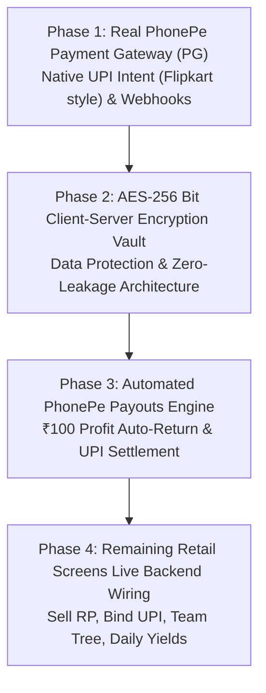

# Quick Money: Next Strategic Phases & Execution Roadmap

> **Author**: Antigravity FinTech Core Engineering  
> **Status**: Ready for Execution & Review  
> **Milestone Achieved**: Super Admin Mobile Management Portal completed with 0 errors, 100% responsive, and strictly < 500 lines per file.

---

## 🧭 Executive Summary of Current State

1. **Super Admin Mobile Suite**: 100% Complete
   - Financial Overview, Users Directory (Freeze/Unfreeze, Ledger Adjustments with two-step confirmations), RP Market Packages (CRUD), PhonePe Payout Desk (NPCI UTR Settlement & Auto-Refund), Platform Settings & Live Yield Engine, and In-App Broadcast Announcements.
2. **Normal User Dashboard & Aesthetics**: 100% Complete
   - Unified Royal Sapphire Top Header with live status pulse, notification badges, ambient animated backgrounds, and cohesive FinTech color schemes.
3. **Architecture Health**:
   - Zero files exceeding 500 lines in `Mobile_app/lib`.
   - `dart analyze` / `analyze_files`: **0 Errors, 0 Warnings**.

---

## 🚀 The 4 Next Strategic Phases



---

## 💳 Phase 1: Real PhonePe Payment Gateway (PG) & Native UPI Intent
> **User Goal**: *"Isme ham real PhonePe ka payment gateway use karenge... jaise Flipkart me direct PhonePe open ho ke payment ho jata hai."*

### 1. How Real PhonePe PG Works (Architecture)
In high-volume FinTech and e-commerce apps (Flipkart, Swiggy, Zomato), when a user clicks **"Buy RP"** or **"Confirm & Pay"**:
1. **Order Initiation (`POST /api/v1/payments/phonepe/initiate`)**:
   - Backend creates a pending transaction and constructs the PhonePe Standard Payload:
     ```json
     {
       "merchantId": "MERCHANTUAT",
       "merchantTransactionId": "TXN_QM_1700000000",
       "merchantUserId": "U_102",
       "amount": 50000, 
       "redirectUrl": "https://quickmoney.app/payment-return",
       "redirectMode": "POST",
       "callbackUrl": "https://api.quickmoney.app/api/v1/payments/phonepe/callback",
       "paymentInstrument": {
         "type": "UPI_INTENT",
         "targetApp": "com.phonepe.app"
       }
     }
     ```
   - Encodes payload in **Base64**.
   - Calculates **X-VERIFY Checksum**:
     $$\text{X-VERIFY} = \text{SHA256}(\text{Base64 Payload} + \text{/pg/v1/pay} + \text{Salt Key}) + \text{###} + \text{Salt Index}$$
   - Sends to PhonePe PG API (`https://api.phonepe.com/apis/hermes/pg/v1/pay`).

2. **Native Mobile UPI Intent Launch**:
   - PhonePe returns an `intentUrl` (e.g., `phonepe://pay?pa=...&pn=...&am=500&tr=...`).
   - Using Flutter URL Launcher / Android Intent, Quick Money launches the **PhonePe App directly on user's phone**!
   - User approves with UPI PIN inside PhonePe.

3. **Server-to-Server Callback (Webhook)**:
   - PhonePe calls backend webhook (`/api/v1/payments/phonepe/callback`).
   - Backend verifies the SHA256 signature, validates `amount` and `merchantTransactionId`.
   - On `PAYMENT_SUCCESS`, the order is marked `completed`, user's RP balance is credited, referral commissions are distributed, and in-app notification is fired!

4. **Fallback Polling / Status Check**:
   - If app resumes before webhook arrives, mobile client checks `GET /api/v1/payments/phonepe/status/:txnId`.

---

## 🔐 Phase 2: AES-256 Bit Client-Server Encryption Vault
> **User Goal**: *"AES-256 bit key env me add kr dena... iss whole app ko AES-256 bit se encrypted banana taki koi hack ya data leak na ho."*

### 1. Client-Side Encryption Layer (`lib/core/security/encryption_vault.dart`)
- Symmetrical **AES-256-CBC with PKCS7 Padding** implemented using random 32-byte (256-bit) Key + 16-byte IV.
- Keys configured in `.env` / `AppConfig` so they can easily be replaced at deployment without altering code.
- Sensitive request fields automatically encrypted before HTTP dispatch:
  - Mobile numbers
  - Account passwords
  - Destination UPI IDs
  - Bank UTR numbers & Transaction References

### 2. Backend Decryption & Storage Vault
- Middleware in `backend/src/middleware/encryption_middleware.js` to intercept and decrypt inbound payloads.
- Stored data at rest in PostgreSQL/SQLite remains encrypted with HMAC-SHA256 search hashes.

---

## 💸 Phase 3: PhonePe Payouts & Automated ₹100 Profit Disbursement
> **User Goal**: *"Jab user ka daily profit ₹100 pahunchega to money automatically user ke bound PhonePe UPI me return ho jaye."*

1. **Automated Profit Accumulator**:
   - Daily yield engine credits 2.5% daily yield to orders.
   - When cumulative accrued order profit $\ge$ ₹100, trigger payout event.
2. **Auto-Return Queue**:
   - If auto-payout is enabled in Admin settings, call PhonePe Disburse API or queue into Admin Payout Desk.
   - Admin can 1-tap approve with NPCI Bank UTR or set auto-settlement.
   - If rejected, amount is instantly refunded to user wallet with in-app notification.

---

## 📱 Phase 4: Remaining Retail Screens Live Backend Wiring & Polish

1. **Sell RP Screen (`features/sell_rp/`)**:
   - Connect to live `POST /api/v1/transactions/request-payout`.
   - Display real bound PhonePe UPI ID, available balance, and live progress bar toward the ₹100 threshold.
2. **Bind Payment Screen (`features/profile/screens/bind_payment_screen.dart`)**:
   - Live PhonePe UPI binding with OTP / VPA verification.
   - AES-256 encryption on UPI address.
3. **Team & Referral Tree (`features/referral/screens/team_screen.dart`)**:
   - Live 3-Tier team hierarchy (L1 Direct 5%, L2 Team 3%, L3 Network 1%).
   - Dynamic invite link sharing with clipboard auto-detection.
4. **Daily Details Screen (`features/daily_details/screens/daily_details_screen.dart`)**:
   - Live compound yield ledger fetching from `GET /api/v1/profits/daily-details`.
5. **Newbie Rewards Screen (`features/rewards/screens/newbie_rewards_screen.dart`)**:
   - One-tap claim of the ₹51.07 welcome bonus.

---

## 📋 Recommended Action Plan (Next Immediate Step)

> [!IMPORTANT]
> **Recommended Step**: **Start with Phase 1: Real PhonePe Payment Gateway (UPI Intent) Integration**.
> This establishes real money flow into the app, letting users purchase RP packages directly via PhonePe just like Flipkart.

### Phase 1 Execution Checklist:
1. **Setup PhonePe PG Credentials in `.env`**:
   - `PHONEPE_MERCHANT_ID`, `PHONEPE_SALT_KEY`, `PHONEPE_SALT_INDEX`, `PHONEPE_ENV` (UAT / Production).
2. **Backend PhonePe PG Controller & Webhook**:
   - Create `backend/src/controllers/phonepe_controller.js`.
   - Endpoints: `POST /initiate`, `POST /callback`, `GET /status/:txnId`.
3. **Mobile App UPI Intent Integration**:
   - In `BuyRpReceiveOrderDialog`: Wire "Confirm & Pay" to initiate PhonePe PG payment.
   - Open PhonePe app directly via `phonepe://` intent URL.
   - Polling status listener & animated success popup.
