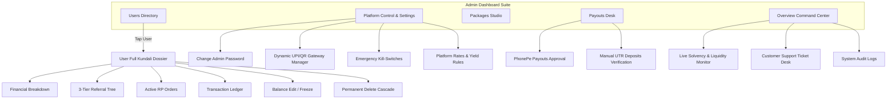

# Quick Money: Super Admin Autonomous Command Suite — Full Research & Master Blueprint 👑

**Document Version:** 1.0  
**Target:** 100% Autonomous Platform Operation (Zero-Developer Dependency)  
**Security Standard:** Role-Based Access Control (RBAC), Double Confirmation Modals, Cascade Integrity  

---

## 1. Executive Summary: The "Zero-Developer" Admin Vision

In a real-money FinTech application, the Super Admin must have **complete autonomous control** over every financial lever, user account, payment channel, and risk setting. The admin should never need to contact a developer, edit `.env` files, or access the database terminal.

Everything happening on the platform must be:
1. **Recorded**: Tamper-proof audit logs for transactions, balance changes, status toggles, and system edits.
2. **Monitored**: Live dashboards tracking platform liquidity, user deposits, payouts, pending UTRs, and active RP orders.
3. **Controlled**: 1-tap adjustments, emergency kill-switches, full user dossier inspection, and permanent deletion.

---

## 2. Core Feature: User "Full Kundali" (360° Comprehensive Dossier)

When the admin taps any trader card in the **Users** tab, an expansive, royal, multi-tabbed **User Kundali Dossier** opens:

### Tab A: Identity & Risk Profile
- **Account ID & Role**: Internal ID, Account Type (`user` / `admin`).
- **Decrypted Phone & Verified Email**: With 1-tap WhatsApp chat and 1-tap Email client dispatch.
- **Account Health**: Active, Frozen, or Suspended status with direct status toggle switch.
- **Registration Timestamp**: Exact date & time of account creation.

### Tab B: Financial Summary & Vault
- **Current Available Balance**: Instant real-time balance.
- **Total Deposited (Buy RP)**: Lifetime sum of approved and PhonePe-settled deposits.
- **Total Settled Payouts (Sell RP)**: Lifetime sum of successful withdrawals.
- **Total Daily Yields Earned**: Total return profits accumulated from active packages.
- **Total Referral Rebates Earned**: Total commission made from L1, L2, and L3 downlines.
- **Net Trader PnL**: Whether the user is in profit or loss on the platform.

### Tab C: Bound PhonePe Wallet & Banking Details
- **Bound App**: PhonePe (`com.phonepe.app`).
- **Account Identifier**: UPI ID / Linked Mobile Number.
- **Account Holder Name**: Verified Name.
- **Binding Date & Status**: Active / Unbound timestamp.

### Tab D: Active RP Market Packages Portfolio
- **Active Orders Count**: Number of currently generating RP packages.
- **Package Details Table**: Package Name, Invested Amount, Daily Yield %, Purchase Date, Total Yield Generated so far.

### Tab E: 3-Tier Referral Deep-Tree
- **Direct Referrer (Parent)**: Who invited this user (Referrer User ID, Email, Invite Code).
- **Direct L1 Referrals**: Total count, cumulative trade volume, and commissions earned.
- **Team L2 Referrals**: Total count and commissions earned.
- **Network L3 Referrals**: Total count and commissions earned.
- **Sub-team Member List**: View names/emails of people invited by this user.

### Tab F: Complete Transaction Audit Ledger
- **Chronological History**: Last 50 transactions of this user (Deposit, Withdrawal, Daily Yield, Referral Commission, Welcome Bonus, Admin Adjustment).
- **Transaction Details**: Transaction ID, Amount, Type, Status, Timestamp, and UTR/Bank Ref Number.

### Tab G: High-Impact Admin Controls
- **Adjust Balance**: Credit or Debit balance with mandatory audit reason.
- **Freeze / Unfreeze Account**: Immediate lock on all transactions and withdrawals.
- **Reset User Password**: Generate temporary password or send reset OTP.
- **⚠️ Permanent Delete User**: Complete removal from platform with safety confirmation.

---

## 3. Core Feature: Permanent User Deletion (Cascade Integrity Engine)

To allow the Super Admin to delete a user permanently without crashing database foreign keys:

### Safety Barriers:
1. **Double Confirmation Modal**:
   - Screen turns amber/red warning tone.
   - Shows user's name, email, and current balance (warnings if user has active balance or pending payouts).
   - Admin must tap **"Yes, Permanently Delete"** or enter confirmation text to prevent accidental taps.

### Backend Cascade Engine:
1. Delete all **Notifications** belonging to user.
2. Delete all **DailyProfit** records belonging to user.
3. Delete all **Transaction** records belonging to user.
4. Delete all **Order** (RP Package) records belonging to user.
5. Delete all **Wallet** (PhonePe) bound records belonging to user.
6. Delete all **Otp** records associated with user's email.
7. Safely detach downline referrals: If other users were invited by this user (`referred_by = user.invite_code`), update their `referred_by` to null or archive it so downline chains remain functional.
8. Delete the **User** record.
9. Log action in **Audit Logs** (`action: 'DELETE_USER', target: userId, adminId`).

---

## 4. Core Feature: Super Admin Change Password

The Super Admin needs the same seamless, secure in-app password change capability as regular users:
- **Location**: In Admin Portal (Tab 4: Settings / Control).
- **Form Fields**:
  1. Current Password (verifies old admin password with bcrypt).
  2. New Password (minimum 6 characters, strong format).
  3. Confirm New Password.
- **Execution**: Sends to `POST /api/v1/users/change-password` with authenticated admin JWT.
- **Security**: Updates bcrypt hash in DB immediately; invalidates old sessions if necessary.

---

## 5. Comprehensive Research: Additional Autonomous Admin Features

To ensure the Super Admin never needs a developer, here are the mission-critical capabilities:

### Feature A: Platform Financial Health & Solvency Monitor ("War Room")
- **Platform Inflow vs Outflow**: Total deposits vs Total withdrawals.
- **System Reserve Solvency**: Compares total user balances vs actual platform reserve funds.
- **Net Platform Profit**: Dynamic profit earned from trading fees or RP spread.
- **High-Risk Trader Alert**: Highlights any user holding >10% of total platform liquidity.

### Feature B: Dynamic Payment Gateway & Manual QR/UPI Manager (Zero-Code)
- **Problem**: Changing UPI ID or PhonePe keys currently requires editing `.env` or code.
- **Solution**: Admin can manage payment settings in real-time from the dashboard:
  - Deposit UPI ID (e.g. `quickmoney@icici`).
  - Account Holder Name (e.g. `Quick Money FinTech Ltd`).
  - Upload / Update QR Code Image URL.
  - Payment Mode Toggle:
    * `AUTOMATED_ONLY`: PhonePe PG Sandbox / Production only.
    * `MANUAL_UPI_ONLY`: QR Code + UTR submission only.
    * `HYBRID`: Users choose between instant PhonePe or manual QR.

### Feature C: Manual UTR Deposit Approval Console
- Users paying via UPI scan the QR code and submit a 12-digit UTR number (`POST /orders/submit-utr`).
- Admin needs a dedicated **UTR Approvals Desk**:
  - Live list of pending UTR submissions: User Email, Amount, UTR Number, Timestamp.
  - 1-Tap **"Approve & Credit"**: Instantly credits user balance, activates their RP package, and triggers referral rebates.
  - 1-Tap **"Reject with Reason"**: Notifies user of invalid UTR code.

### Feature D: System Emergency Circuit Breakers (Kill-Switches)
- ⚡ **Emergency Market Freeze**: Instantly halts all Buy & Sell RP transactions across the app during high volatility or audit.
- 🔒 **Payout Lockdown**: Pauses automated and manual withdrawals while keeping trading active.
- 🚧 **Maintenance Mode Toggle**: Puts mobile app into a beautiful animated "Maintenance / System Upgrade" screen for regular users, while Admin retains full access.

### Feature E: In-App Customer Support Ticket Desk
- Users submit tickets from `/customer-support`.
- Admin needs a dedicated Support Desk tab:
  - Filter tickets: Open, In Progress, Resolved.
  - Read user inquiry and view attached contact details (WhatsApp/Phone).
  - Send direct in-app response: User receives real-time notification with admin's reply.
  - 1-Tap **Mark as Resolved**.

### Feature F: Dynamic Package & Yield Rule Studio (Full Visual CRUD)
- Create new investment packages (e.g., ₹2,500 with 2.6% daily yield) directly from the UI.
- Edit existing package prices, yields, and limits.
- Toggle package visibility (Active / Inactive) with 1 click.
- Change Global Rules: Daily Yield Rate (2.5%), Referral Rebates (L1: 5%, L2: 3%, L3: 1%), Minimum Payout (₹100), Welcome Bonus (₹51.07).

### Feature G: Visual Daily Yield Scheduler & 1-Tap Manual Cycle Trigger
- Shows cron status: Last cycle execution time, next scheduled run, total money distributed today.
- 1-Tap **"Run Daily Yield Cycle Now"** button with live progress indicator.

### Feature H: Tamper-Proof System Audit Logs (Flight Recorder)
- Complete chronological audit log of all administrative actions:
  - Who: Admin ID & Email.
  - What: Action performed (`BALANCE_ADJUST`, `STATUS_FREEZE`, `PAYOUT_SETTLE`, `USER_DELETE`, `SETTINGS_CHANGE`, `BROADCAST`).
  - Target: Affected user or setting.
  - Metadata: Old value vs New value, Timestamp, IP address.
- Provides 100% legal and operational transparency for platform audits.

---

## 6. Architecture & Implementation Phasing

### Module Breakdown:
1. **Phase 1: User Kundali, Permanent Delete & Admin Change Password** (Immediate Core).
2. **Phase 2: Manual UTR Approval Console & Dynamic UPI/QR Gateway Manager**.
3. **Phase 3: Customer Support Ticket Desk & Emergency Kill-Switches**.
4. **Phase 4: System Audit Logs & Live Solvency Monitor**.
